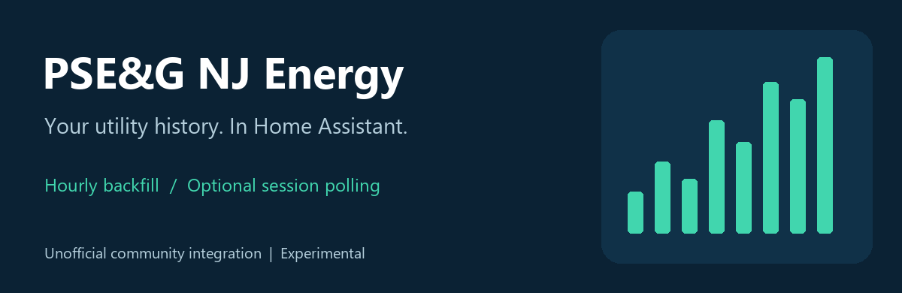
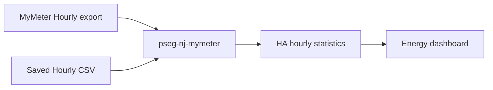

# PSE&G NJ Energy



[](https://github.com/brylee123/ha-pseg-nj/releases)
[](https://github.com/brylee123/ha-pseg-nj/actions/workflows/ci.yml)
[](https://www.hacs.xyz/docs/faq/custom_repositories/)
[](https://pypi.org/project/pseg-nj-mymeter/)
[](LICENSE)

[Install with HACS](#install-with-hacs) · [Releases](https://github.com/brylee123/ha-pseg-nj/releases) · [Report an issue](https://github.com/brylee123/ha-pseg-nj/issues) · [Changelog](CHANGELOG.md)

Unofficial community project; not affiliated with or endorsed by PSE&G.
The illustration above is project artwork, not a screenshot of live energy data.

Experimental custom integration, v0.2.1, targeting Home Assistant 2026.10+.
Backfills PSE&G NJ MyMeter electricity history into the Energy dashboard and
optionally polls the Hourly export using an existing session. Password login,
MFA automation and automatic session renewal are not implemented.

## Install and upgrade

1. Back up HA, including Recorder and `.storage`.
2. Extract the release and copy `custom_components/pseg_nj` to
   `/config/custom_components/pseg_nj`, replacing v0.1 if installed. Restart HA.
3. Add **PSE&G NJ Energy** in Settings → Devices & services. Enter a stable
   statistic label and the displayed meter number, including leading zeroes.
4. HA installs `pseg-nj-mymeter==0.2.0` from PyPI automatically. Leave the cookie blank to start with CSV-only mode. If supplied, a session
   is validated against the export form before the entry is created.

Existing v0.1 entries migrate automatically: meter/config/statistic IDs and the
ledger stay stable; the session cookie moves from options into credential data.
The import action no longer accepts `interval_minutes`. Use an **Hourly** export.
Existing v0.1 aggregated history is preserved and can be replaced by overlapping
hourly imports without adding the energy twice.

## Install with HACS

[](https://my.home-assistant.io/redirect/hacs_repository/?owner=brylee123&repository=ha-pseg-nj&category=integration)

1. Install and configure [HACS](https://www.hacs.xyz/docs/use/).
2. Click the button above, or open HACS > Custom repositories and add
   `https://github.com/brylee123/ha-pseg-nj` with category **Integration**.
3. Download **PSE&G NJ Energy**. Enable prerelease versions for the experimental release if needed.
4. Restart Home Assistant, then add the integration:

[](https://my.home-assistant.io/redirect/config_flow_start/?domain=pseg_nj)

Requires Home Assistant **2026.10.0+**, HACS for this installation method, and internet access to install the PyPI dependency. HACS default-store inclusion is not claimed. For manual installation, use the release's `pseg_nj.zip`: extract its contents into `/config/custom_components/pseg_nj/` and restart.



## Backfill electricity history

Export **Hourly** usage from MyMeter. Keep `Read Date`, `Meter` and `kWh` selected;
identity and dollar columns are ignored. Copy the file to
`/config/pseg_nj/usage.csv`, then run this under Developer Tools → Actions:

```yaml
action: pseg_nj.import_csv
data:
  entry_id: YOUR_CONFIG_ENTRY_ID
  filename: usage.csv
```

The **Import entry ID** diagnostic sensor provides the entry ID. The action
returns row/hour/skip counts, changed-hour count and retained ledger-hour count.
Those results mean Recorder writes were queued; inspect Statistics to confirm
processing. The parser requires at least two consecutive hourly readings to
distinguish Hourly from coarser exports with identical headers. Gaps elsewhere
are allowed. A file with invalid values/duplicate times fails before changing
the ledger. Billing, Daily, 30-Minute and 15-Minute exports are rejected.

Choose `pseg_nj:<label>_energy` / **PSE&G NJ <label> electricity** as grid
consumption in Energy settings. These are external statistics, not a live
consumption sensor. The sensor platform exposes diagnostic counts and import
status only. Re-imports replace overlapping hours and recompute subsequent sums.
A carry-forward baseline before each contiguous segment counts its first hour
without claiming measured zero usage during a gap.

HA's short-term summaries are five-minute records, but the supported external
historical-statistics import API writes hourly long-term records and requires
top-of-hour timestamps. There is no supported 15-minute external backfill API
in the checked HA 2026.10 implementation. This integration therefore uses the
Hourly export directly. See [GETTING_STARTED.md](GETTING_STARTED.md) for sources.

## Optional session polling

Use the integration's **Reconfigure** menu to enter a Cookie header value from
your own authenticated NJ MyMeter session. Enter it directly into HA; treat it
as a password. It is saved in HA's config entry and can appear in backups. No
secret or raw response is included in diagnostics or logged by this integration.

The coordinator fetches the previous seven days through yesterday every 12
hours, using a fresh verification token and the configured meter's current
internal ID. It does not save portal download settings. A first refresh validates
setup before entities are forwarded. Connection failures retry through HA's
normal coordinator/setup handling. Expired sessions trigger native reauthentication.
Diagnostic entities follow coordinator availability; the static import-ID entity
remains available during a running-entry cloud failure. Recorder history remains.

Supply a replacement session in **Reauthenticate**, or submit a blank cookie
there/in **Reconfigure** to switch to CSV-only mode. If setup cannot load with an
expired session, switch to CSV-only mode before invoking the import action.

## Limitations

* Electricity import only. No gas, solar export/net metering or costs.
* Local CSV timestamps are interpreted in `America/New_York`. Ambiguous fallback
  and nonexistent spring-forward times are skipped and counted, never assigned
  a guessed offset. Thus the DST hour may be missing.
* The portal's separately exported Hourly values can differ from sums of its
  rounded 15-minute values. Source-resolution differences are not corrected by
  inventing usage; compare against the matching portal Hourly view.
* The ledger stores UTC hour → kWh under `.storage/pseg_nj_<entry_id>`. It does
  not store raw CSV, account numbers, names or addresses. Do not delete the ledger
  independently of its recorder statistics. Corrections/backfills replay the
  retained history, which may take time on a Pi.
* Session polling has recorded-form and transport-test coverage but still needs
  live authenticated server and HAOS testing. Portal changes can break it.

## Remove or troubleshoot

Remove the config entry in Devices & services to stop polling and unload entities.
Recorder history and the saved ledger are deliberately retained. Use HA's normal
Statistics tools if you later want to delete the history, after making a backup.
Do not manually edit the Recorder database. Remove the component folder only
after unloading/removing its entries.

If a sensor is unavailable, check for a reauthentication prompt and the integration
log. If a CSV fails, verify Hourly granularity, the meter number, UTF-8 encoding
and its location directly under `/config/pseg_nj`. If Energy is empty, check the
external statistic's unit/issues and select historical dates actually imported.

## Development

Install `requirements-dev.txt` in a virtual environment. From this directory:

```text
python -m pytest
python -m ruff check .
python -m ruff format --check .
python scripts/check_runtime_dependency.py
python -m build library
```

The published standalone library is [pseg-nj-mymeter 0.2.0](https://pypi.org/project/pseg-nj-mymeter/0.2.0/).
The integration imports it normally; no protocol library is bundled inside the component.
`library/src/pseg_mymeter` retains the separately buildable library project for future development.
Integration tests resolve the installed distribution rather than that source tree.

`tests/unit` runs locally, including explicit HA interface doubles for ledger
atomicity/replay tests. `tests/ha` contains native Home Assistant tests; install
the matching `pytest-homeassistant-custom-component` framework in a compatible
Linux/HA environment and run `python -m pytest tests/ha`. Native configuration,
setup, migration, reauthentication, service and diagnostics tests pass on HA
2026.10.4 with Python 3.14.7. See [GETTING_STARTED.md](GETTING_STARTED.md) for the full
five-page alignment audit, completed official tooling checks and remaining live verification.
